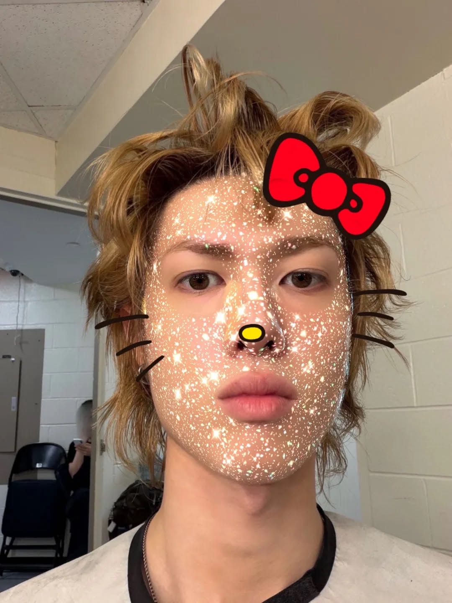
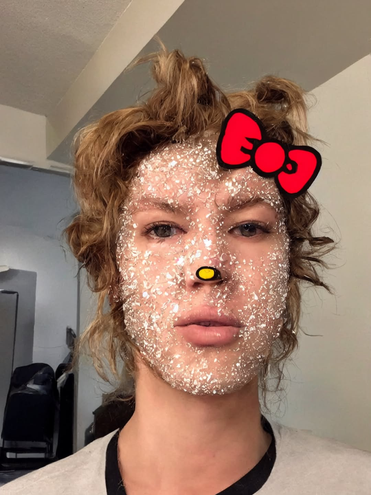
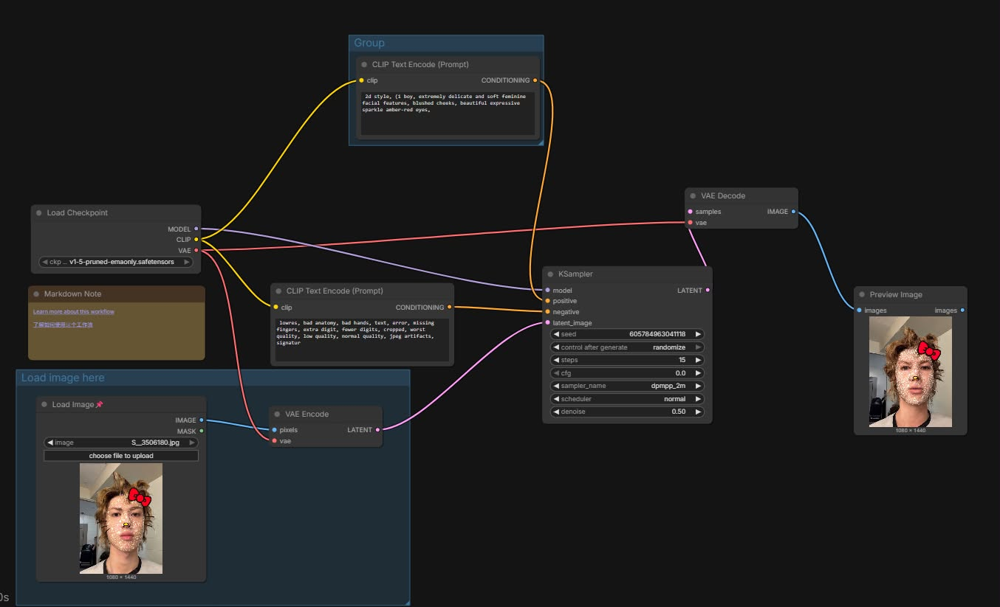

# 原圖(使用自己的照片)

# 生成的圖

# 完整工作流截圖

# 顯示使用的正反提示詞
- 2d style, (1 boy, extremely delicate and soft feminine facial features, blushed cheeks, beautiful expressive sparkle amber-red eyes)
# 個人心得
- 這次做網站讓我學到很多，更了解用法。雖然過程中遇到一些問題，但是完成後很有成就感。
